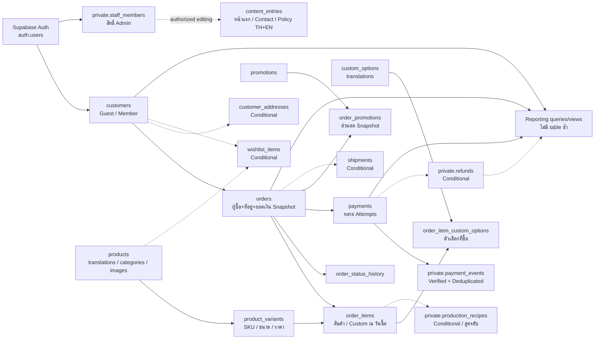

# Perfume POC — DB proposal และจุดเชื่อม

สถานะ: Proposed / review only · 5 ตุลาคม 2026 · ไม่มี migration หรือ remote database write

ผู้ใช้เลือกใช้คำแนะนำเป็นฐานชั่วคราวเพื่อเห็นภาพรวม ไม่ใช่รับรองสูตร ราคา Provider หรือ schema ใช้งานจริง เอกสารเดิมยังอยู่ครบใน `.docs/perfume/db.md`; ชุดนี้ต่อยอดจากชื่อและความสัมพันธ์เดิม พร้อม DBML สำหรับแชร์ ไม่แก้ archive หรือ implementation

- [DBML สำหรับ dbdiagram](schema-proposal.dbml)
- [DBML แบบจุดเชื่อมให้ทีมออกแบบต่อ](schema-integration-outline.dbml)
- [กติกา Shared / Owner designs และเจ้าของตาราง](db-integration-outline.md)
- [คำถามและผลต่อ schema](db-open-questions.md)

## เปิด diagram

เปิด [dbdiagram editor](https://dbdiagram.io/d) แล้ว copy เนื้อหา `schema-proposal.dbml` ทั้งไฟล์ลง editor หรือใช้ Import DBML ตาม UI ที่มีในบัญชี ใช้ข้อมูล schema สมมติเท่านั้น ไม่มี credentials/customer data ในไฟล์ ยังไม่ได้ publish หรือสร้าง diagram ในบัญชีภายนอกให้

**สีฟ้า** = ฐานที่เสนอ · **สีส้ม** = เพิ่มเมื่อ requirement รับรอง · **สีเทา** = ตาราง Supabase จัดการเอง ไม่สร้างซ้ำ

มี **20 ตารางฐานที่เสนอ + 5 ตาราง Conditional + 1 ตารางอ้างอิง auth.users** รวม 26 กล่อง ไม่ใช่คำสั่งให้สร้างทั้ง 26 ตาราง DBML ใช้ PK/FK และ composite keys แสดง cardinality ตาม [DBML syntax](https://dbml.dbdiagram.io/docs/)

## ฐานชั่วคราวที่ใช้วาด

| เรื่อง | ใช้ใน diagram | ยังไม่ถือเป็นข้อสรุปของร้าน |
|---|---|---|
| ตลาด | ร้านเดียว TH/EN, ราคา THB, ส่งในไทย | Currency/market/shipping/tax ต้องยืนยัน |
| ลูกค้า | Customer แยกจาก nullable verified Auth link รองรับ Guest+Member | วิธี Login/Guest order access/deduplication |
| สินค้า | Product → Variants, translations แยก locale | Dimensions, categories, publication rules |
| Custom | เก็บ options ที่ลูกค้าเลือก ณ สั่งซื้อ; ร้านกำหนด ratio | ราคา ขนาด ข้อจำกัด สูตร วันเกิด และว่าจะเก็บ recipe ไหม |
| ราคา Custom | รองรับ Order เมื่อมีราคา final ที่ server รับรองแล้ว | ไม่เลือก fixed/component/quote pricing แทนร้าน; quote-first จะเพิ่ม tables |
| Stock | Manual availability | ไม่มี inventory/reservation โดยปริยาย |
| เงิน | Integer minor units + currency; Sandbox เท่านั้น | Provider, tax/rounding, refund/state transitions |
| Promotions | หนึ่งชนิดที่รับรองและหนึ่งรายการต่อ Order ก่อน | ยังไม่เลือกเปอร์เซ็นต์/ลดบาท/ส่งฟรีหรือโควตา |
| วันเกิด | ไม่เก็บ raw DOB; snapshot เฉพาะผลที่รับรอง | Result structure และ retention |
| Cart | Client draft; server คิดใหม่เมื่อ checkout | Cross-device cart ไม่รวมในฐาน |

## จุดเชื่อมแบบภาพรวม

ลูกศรในภาพรวมหมายถึง dependency/data link; FK จริงและจำนวนความสัมพันธ์ดู DBML การดูแล Admin ไม่ใช่ FK จาก staff ไปทุก row สิทธิ์ต้องตรวจใน operations

## Feature → ตาราง → หน้า → ผู้ดูแล

| Feature | ตารางหลัก | หน้าที่ใช้ | ผู้ดูแลหลัก |
|---|---|---|---|
| catalog | products, product_variants, product_translations, categories, category_translations, product_categories, product_images | รายการ/รายละเอียดสินค้า; Admin เพิ่ม/แก้ | สมาชิก 1 |
| account/customers/access | customers, auth.users reference, private.staff_members | Login/profile เมื่อรับรอง; Admin ลูกค้า; authorization | สมาชิก 3 |
| custom-perfume | custom_options, custom_option_translations, order_item_custom_options | Custom wizard; Admin custom; summary ใน Order | สมาชิก 3 นิยาม selection; สมาชิก 4 persist กับ Order |
| checkout/orders | orders, order_items, order_status_history | Checkout, Order detail/tracking, Admin orders | สมาชิก 4 |
| payments | payments, private.payment_events | Payment result และสถานะธุรกรรม | สมาชิก 4 |
| promotions | promotions, order_promotions | Admin promotions; server discount ใน Checkout | สมาชิก 1 นิยาม; สมาชิก 4 persist snapshot |
| content | content_entries | Landing/Contact/Policies; Admin content | สมาชิก 2 |
| reporting | queries/views อ่าน facts ที่รับรอง | Dashboard/รายงาน | สมาชิก 1 |
| Conditional | customer_addresses, wishlist_items, private.production_recipes, shipments, private.refunds | Saved address/Wishlist/สูตรผลิต/เลขติดตาม/คืนเงิน | 3 / 2 / 3 / 4 / 4 ตามลำดับ |

ตารางเดียวกันใช้ทั้งหน้าร้าน/หลังบ้าน ไม่สร้าง admin_products แยกจาก products และไม่สร้าง table ต่อหน้า เช่น payment result อ่าน payments; Order history อ่าน orders ไม่สร้างประวัติอีกชุด

## เหตุผลและ boundaries

1. **Product กับ Variant แยกกัน:** ข้อมูลกลิ่นไม่ซ้ำตามขนาด และ Order อ้าง SKU ที่ขายจริง; variants ไม่บังคับทุกมิติที่ร้านยังไม่ยืนยัน
2. **Customer กับ Auth แยกกัน:** Guest มี customer identity ได้โดยไม่มีบัญชี; contact email ไม่ใช่หลักฐานว่าเป็นเจ้าของ Order และไม่ merge อัตโนมัติ
3. **Order เก็บ snapshot:** เปลี่ยนชื่อสินค้า ราคา ที่อยู่ หรือโปรโมชั่นภายหลังไม่เปลี่ยนสิ่งที่ซื้อไปแล้ว FK ใช้ trace ส่วน snapshot ใช้ประวัติ
4. **Options ไม่ใช่สูตรผลิต:** ลูกค้าเห็นตัวเลือกที่สั่ง แต่ไม่เห็น ratios/สูตรลับ DBML สูตรผลิตเป็น Conditional private table; ส่วนผสมทางการผลิตอาจเป็นคนละ entity ถ้าร้านต้องการ inventory
5. **Order ไม่เท่ากับ Payment attempt:** การจ่ายใหม่มี attempts เพิ่มใน Order เดิม เก็บ verified event IDs แยกและคุม transition ให้ fulfill ครั้งเดียว แม้ Provider ส่ง distinct success events หลายครั้ง
6. **สูตรแนะนำไม่ใช่ generic rules engine:** ใช้ code/version identifier ได้เมื่อร้านส่งกติกา; ไม่สร้าง rules table จน Admin-editable format ชัด ไม่เก็บ raw DOB ใน public selections
7. **Content ยืดหยุ่นเฉพาะข้อมูลหน้า:** JSONB ต้องมี per-key schema/version ไม่แทน FK/เงิน/queryable ownership ด้วย JSON และไม่เก็บ draft ภายใน row ที่เปิด public
8. **Reporting ไม่มี copied totals table:** เริ่มจาก query ตามนิยาม paid/refunds/date/currency ที่รับรอง; materialized views พิจารณาเมื่อ performance มีหลักฐาน

## สิ่งที่ diagram ยังไม่ได้รับรอง — ต้องมีใน migration จริง

- **Keys / indexes:** UUID PK, composite PK สำหรับ translations/joins และ index ที่ FK/read paths; การสร้าง timestamps/default UUID/updated_at triggers ต้องเลือกใน migration ไม่อนุมานจาก diagram
- **Validation:** quantity > 0, money >= 0, positive size, allowed locales/status/kinds, end > start, ขอบเขตส่วนลด, nonblank identifiers และ normalized code uniqueness
- **Cross-row invariants:** Standard item มี Variant; selections อยู่ Custom เท่านั้น; eligibility/ราคา/available ตรวจบน server; totals และ snapshots ตรงกัน; currency ตรงกัน; custom count/compatibility จากร้าน
- **Transactions:** Order+items+choices+discount+history ต้อง commit พร้อมกัน; checkout idempotency ตรวจ owner และ payload; retry key เดิมไม่สร้าง Order/charge ซ้ำ; Payment state transition ใช้ lock/conditional update
- **Promotion:** Baseline หนึ่งโปรโมชั่นต่อ Order ต้องเพิ่ม UNIQUE(order_id) ที่ order_promotions หลังรับรอง ไม่ปล่อย composite PK ให้ใช้หลายโปรโมชั่นโดยไม่ตั้งใจ; quota ต้องมี transaction-safe reservation/redemption
- **Refund:** การยกเลิกไม่เท่ากับคืนเงินจริง; aggregate refunds ไม่เกินยอดยืนยัน; deduplicate Provider refund IDs รวม context Provider/environment; partial refund ต้อง allocation model เพิ่ม
- **Deletion:** Archive สินค้า/โปรโมชั่นที่ถูกอ้างอิง; restrict ประวัติการเงิน; user deletion ไม่ cascade ลบ Orders; customer anonymization/retention รอ policy
- **Snapshots:** Runtime validation+schema version; immutable commercial snapshots หลัง placed; เปลี่ยนที่อยู่หลังสั่งต้อง workflow/audit ที่รับรอง ไม่แก้ profile แล้วให้ Order เปลี่ยนเอง

## Supabase access ที่ต้องออกแบบต่อ

RLS เปิดทุกตารางใน exposed schema พร้อม grants ที่ตรง actual access model; RLS ไม่ใช่ column masking และการใส่ตารางใน `private` เพียงชื่ออย่างเดียวไม่กันการเปิด API ต้องตรวจ exposed schema/grants จริง ดู [Supabase RLS](https://supabase.com/docs/guides/database/postgres/row-level-security)

| ข้อมูล | Access ที่เสนอเพื่อ review |
|---|---|
| products/options/translations/images/categories/content | Public อ่านเฉพาะ published/enabled records และตรวจ parent publication ของ children; Admin แก้ตาม permission |
| customers/saved addresses/wishlist | สมาชิกเข้าถึงของตนหลัง verified linkage; Guest ไม่มี public customer/history read; Admin อ่านตามสิทธิ์ |
| orders/items/choices | Customer-safe projection ตาม ownership หรือ approved scoped guest token; server-only mutations; ห้าม client เปลี่ยนยอด/สถานะ |
| payment/history | Public-safe status projection ตาม Order access; provider IDs/internal reasons ไม่เปิดจากตารางดิบ |
| staff_members/payment_events/recipes/refunds | Private unexposed schema + restricted grants/authorized server-only operations; ไม่ใช้ service key ใน browser |

`auth.users` ใน diagram มีแค่ PK สำหรับ FK ไม่ใช่ schema Supabase Auth ที่เราสร้าง; refer เฉพาะ managed PK และทบทวน deletion/linkage ตาม [Supabase user data](https://supabase.com/docs/guides/auth/managing-user-data)

## ลำดับทำจริง

1. รับรอง Catalog fields/Variant/translation/availability ก่อน แล้วทำ Admin → store slice
2. รับรอง Guest access/staff roles และออกแบบ grants/RLS พร้อม identity tables ก่อนเปิดข้อมูลลูกค้า
3. รับรอง custom examples/options/size/final price แล้วเชื่อม selections → Cart → Order; ถ้ายังไม่มีราคา ห้ามสมมติ charge
4. รับรอง shipping/tax/totals/lifecycle แล้วทำ Orders transaction และ snapshots
5. เลือก Sandbox provider แล้วทำ attempts/events/idempotency/verified status พร้อม checks ผ่าน endpoint จริง
6. เพิ่ม promotions/content ที่รับรองและ reporting จาก facts; Conditional tables เปิดเป็นการ์ดแยกเมื่อจำเป็น

เก็บ Cart เป็น client draft ได้ก่อน แต่ข้อมูล browser ไม่ใช่ราคาหรือสิทธิ์ที่เชื่อถือได้ ต้องคิดใหม่เมื่อ checkout เอกสารนี้ไม่สร้าง migrations/generated Database types/query code และไม่ส่ง schema ขึ้นบัญชี dbdiagram ภายนอก

## สถานะตรวจ

ตรวจ declarations/relationships และความสอดคล้องของไฟล์ locally: 26 tables, 29 FK references, 6 groups, 5 Conditional tables, 38 question IDs ไม่ซ้ำ และ local links ผ่าน

แก้ syntax สีวันที่ 5 ตุลาคม 2026: `headercolor: #2563EB` ต้องใช้ color literal ไม่มี quote ตาม [DBML Colors](https://dbml.dbdiagram.io/syntax/enrichment-visualization/#colors) ทั้งชุดละเอียดและชุดย่อผ่าน `@dbml/core@10.2.0` ทั้ง `dbml` และ `dbmlv2` (26 tables ต่อชุด) ด้วย [parser check](../../scripts/dbml.check.cjs) โดยใช้ parser ที่ติดตั้งภายนอกโปรเจกต์ผ่าน NODE_PATH ไม่เพิ่ม dependency ใน package/lockfile

ยังไม่ apply SQL, ทดสอบ RLS/transactions/HTTP/provider หรือเปิดใน dbdiagram editor การผ่าน parser ไม่พิสูจน์ database runtime หรือผลการจัด layout ใน browser

Supabase changelog endpoints ดึงไม่สำเร็จในการตรวจครั้งนี้ ใช้เอกสาร RLS/User data ที่เปิดได้สำหรับ proposal; ต้องตรวจ changelog/API ที่เกี่ยวข้องอีกครั้งก่อน implementation
